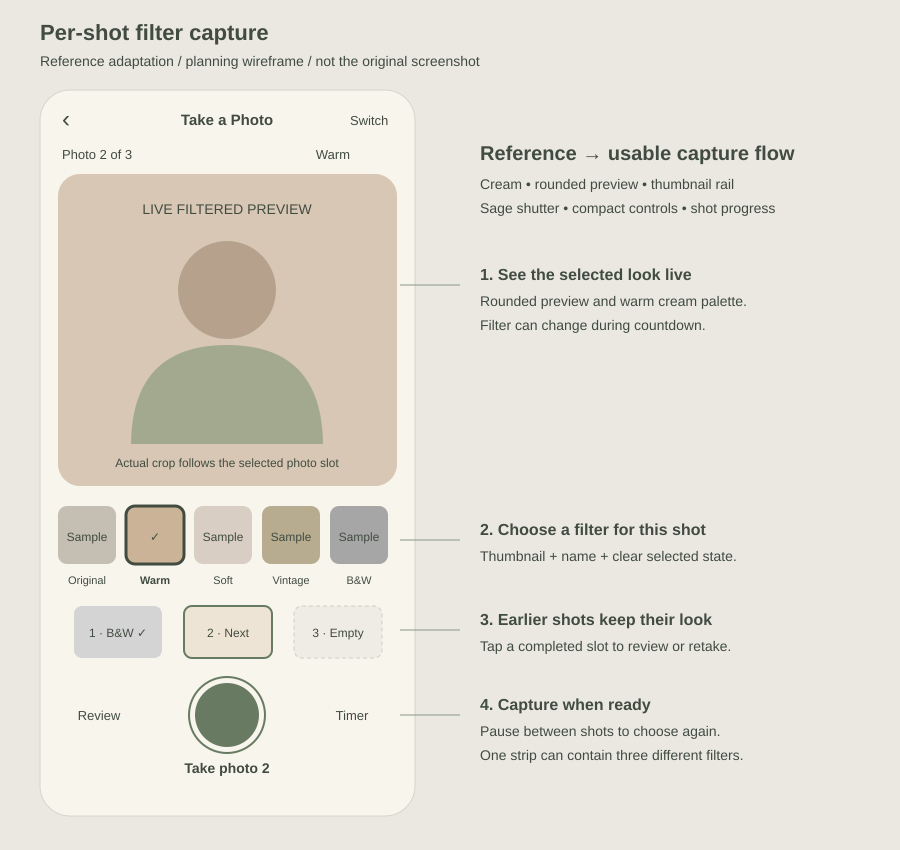

# Per-shot filters and capture UI plan

Date: 2026-10-16. Status: planning only; application changes have not started.

## 1. Goal and scope

Let the user choose a different photo filter for every photo slot in one finished layout. Example: a three-photo strip contains Warm, B&W, and Vintage photos, in that order. Changing the next shot's filter must never change photos already captured. Here, a slot means one photo window; a template/frame means the surrounding design.

Deliver the local booth experience first, then extend the same controls to the two-person Friends flow as a separate integration phase. Keep React/JSX, browser-side processing, existing storage, and static deployment. No paid APIs, new backend, or cloud photo uploads are needed for filters.

## 2. UI reference supplied by the user

Primary visual reference: the screenshot attached to the chat request on October 16, 2026. It shows a cream mobile camera screen, centered “Take a Photo” title, back control, large rounded photo preview, five labeled filter thumbnails (Original, Warm, Soft, Vintage, B&W), a dark selected-thumbnail outline, and a large sage-green circular shutter with smaller secondary controls.

The original attachment is visible in chat but was not available as a local asset in the inspected workspace. The embedded SVG below is an annotated layout adaptation, not a copy of the original screenshot. This document preserves its visual direction and the proposed behavior without a broken image link.

### Visual specification

| Area | Planned treatment |
| --- | --- |
| Background | Warm cream, approximately #F8F5ED; dark olive text #414B40 |
| Header | Back button, centered “Take a Photo”, camera-switch button; accessible names for icons |
| Preview | Rounded corners around 20–24px; largest region; use the actual current slot aspect ratio so the crop is honest |
| Current shot | “Photo 2 of 3” and “Warm” visible above/below preview |
| Filter rail | Five thumbnail buttons using the same locally bundled sample photo; filter name below each; horizontal scroll on small screens |
| Selection | Olive outline plus checkmark and pressed state; never rely on color alone |
| Shutter | Approximately 72px sage circle (#687A61), contrasting ring, visible “Take photo 2” label |
| Secondary actions | Captured-shot review on the left and countdown setting on the right; camera switching remains in the header |
| Shot progress | Compact captured thumbnails with slot numbers and filter labels; placeholder for the next shot |
| Spacing | 16–20px page padding, 8–12px control gaps, minimum 44px touch targets |

The reference's gallery-like icon becomes an in-session captured-shot review control, not an entry into the operator's saved gallery. Do not copy an ambiguous icon without a clear function. Countdown settings use the existing allowed values and apply to the next shot only. Keep advanced settings outside the main capture view.

Mobile: preview, filter rail, progress, and shutter remain easy to reach; account for safe-area insets and short screens, allowing vertical scrolling instead of clipping. Tablet/desktop: centered camera panel with a compact strip preview beside it. Landscape: two columns where space allows. Keep the preview's real crop rather than forcing the screenshot's dimensions onto every layout.

## 3. Current implementation findings

- `src/pages/Camera.jsx` starts a loop that captures every layout photo after one shutter press. There is an 850ms pause between shots, and back/switch/shutter are disabled while busy. There is no photo-filter selection or filter-processing stage.
- Captures are JPEG Blobs, passed through `onComplete(photos)` to `prepare()` in `src/App.jsx`. Final preview currently offers a whole-session retake.
- `src/services/images.js` and `src/services/template-renderer.js` compose those images into layouts/templates. Apply filters to individual captures before these composition functions receive them, so borders, logos, and text retain their colors.
- `src/data/booth.js` defines one-, two-, three-, and four-photo layouts. Progress and completion must use the actual layout count.
- Friends has a separate capture path: `src/services/friends/photos.js`, `session.js`, and `src/pages/Friends.jsx`. `advance()` immediately schedules the next pose after transfers finish. Editing only `Camera.jsx` would not enable filters in Friends.
- `build/offline-plugin.js` currently enumerates public files and built assets. New local filter thumbnail assets must be included in a verified offline build.

## 4. Recommended interaction

Default to **one shot at a time**, with no automatic next-shot deadline. This gives users enough time to select a filter and pose.

1. Open capture with Original selected and Photo 1 of N visible.
2. Tap a thumbnail; update the live preview immediately without reopening the camera.
3. Tap the shutter to start the existing countdown. Allow filter changes during countdown; the visible selection at exposure is the one saved.
4. At exposure, snapshot the active filter ID and draw the video frame synchronously. Lock filter and shutter controls during frame processing; show a brief capture flash.
5. Add the processed photo and its filter label to progress. Unlock the next slot with the last chosen filter still selected.
6. Wait for another shutter press. The user can keep the previous filter or choose a new one.
7. After the last shot, show the existing composed review. All individual filters remain visible in the final output.

Example: Warm -> capture photo 1 -> select B&W -> capture photo 2 -> select Vintage -> capture photo 3 -> finished mixed-filter strip.

Captured-shot review allows selecting a completed slot and choosing “Retake this photo.” Retaking replaces that slot only after a successful capture. Cancel keeps its previous image and filter; after replacement, return to the next incomplete slot or completed review. Final review also gains access to this slot review; retain “Retake all” with a confirmation before discarding the session.

An automatic sequence mode is deferred. If later retained as an option, it needs an explicit between-shot selection pause and must not silently use the old 850ms interval for choosing filters.

## 5. Filters and image pipeline

| Filter | Initial look |
| --- | --- |
| Original | Unmodified colors |
| Warm | Gentle warmth and slightly richer saturation |
| Soft | Reduced contrast and slightly brighter tones; no face smoothing or blur |
| Vintage | Muted saturation, mild sepia tone, gently lifted dark tones |
| B&W | Neutral grayscale with modest contrast |

Tune exact strengths against representative portraits and multiple skin tones during implementation. These are color presets, not AI effects.

Create a single filter registry with stable IDs, labels, versioned recipes, and thumbnail mapping. Use a shared browser renderer for filtered live preview and saved pixels. Prototype low-resolution canvas preview and full-resolution still processing first; prefer simple pixel color transforms for these five presets so effects do not depend solely on `CanvasRenderingContext2D.filter`. Benchmark on physical iPhone/iPad and Android before selecting the final rendering path. If optimized canvas/CSS paths are added, verify parity against the shared reference renderer.

Keep the camera video element as the source. For each exposure: read the current filter ID -> draw the source with existing mirror behavior -> apply the frozen recipe -> encode once -> retain the processed Blob. Keep any raw working canvas transient; post-capture re-filtering is outside this scope. Composition must not apply a second filter. Clean up animation loops, temporary canvases, ImageBitmaps if used, and object URLs when leaving or replacing a shot.

Static filter thumbnails avoid five continuously processed live previews. Their sample must be bundled, locally available, and approved for use; do not crop the people from the user's UI reference into production assets.

## 6. Session state and race protection

Suggested capture state: `ready -> countdown -> processing -> betweenShots -> countdown ... -> review`, with `error` and cancellation paths.

Suggested session shot record: `{ slotIndex, blob, filterId, filterVersion }`. Keep this in session state, above the camera page if needed for final-review retakes. Adapt to the existing composition contract with ordered `shots.map(shot => shot.blob)`; do not require a persisted gallery schema change just to save filtered output.

- Maintain the selected filter in state and a current-value ref so countdown closures do not save a stale selection.
- Snapshot filter, slot index, facing, and mirror at exposure; never read mutable filter state after asynchronous encoding starts.
- Keep existing generation-token cancellation and busy guards. Rapid taps cannot create duplicate captures or append to an abandoned session.
- Permit camera switching only between shots; retain completed captures. Retry should preserve completed slots and clear the interrupted countdown.
- On page hiding/camera loss, invalidate pending work, clear flash/countdown, and explain how to resume. Do not silently reset completed photos.
- Back/retake-all with captured photos asks before discarding. Canceling that dialog changes nothing.
- Unknown filter IDs fall back to Original. A rendering failure shows an error and permits retry or explicitly choosing Original; never silently save a different look.

## 7. Friends integration phase

Each participant chooses their own filter for their own camera. Both participants may choose different filters within the same row. Keep exactly two participants and existing transfer-size checks.

1. Add the reusable filter rail and processed local preview to `Friends.jsx`.
2. Introduce a between-pose stage after both images and acknowledgments complete. Replace immediate next-pose scheduling with readiness from both participants.
3. Each participant confirms readiness for the next pose; readiness is scoped to generation and shot. Host schedules only when both are ready. Reset, leave, and disconnect clear readiness.
4. Allow local filter switching through countdown; snapshot and bake each participant's filter at their synchronized exposure. Transfer the resulting JPEG using existing validation and limits.
5. The peer's raw live WebRTC feed will not show the local filter automatically. Label it as an unfiltered live feed; display the actual filtered result after still transfer. Sending a processed video stream is a separate enhancement.
6. Version and validate any new readiness protocol messages; reject mismatched peers clearly. Preserve current timing safeguards, stale-message rejection, cancellation, and both-person final approval.
7. Local individual-slot retake does not imply independent Friends retake. Keep the existing synchronized Friends retake/reset behavior in this phase; coordinate any later per-row retake as a separate protocol change.

## 8. Planned files

| File | Planned change |
| --- | --- |
| `src/data/filters.js` (new) | Stable filter registry and recipes |
| `src/services/photo-filters.js` (new) | Shared color processing and preview/still helpers |
| `src/components/FilterPicker.jsx` (new) | Accessible thumbnail rail |
| `src/components/CaptureProgress.jsx` (new) | Slot thumbnails, labels, selection |
| `src/pages/Camera.jsx` | Single-shot state flow, per-shot filter snapshot, retakes |
| `src/App.jsx` | Retain session shot records for targeted retakes; adapt composition inputs |
| `src/App.css` | Reference-inspired responsive camera styles, scoped to capture UI |
| `src/services/images.js` | Reuse capture utilities if extraction is needed; preserve output composition |
| `public/filters/` (new) | Approved local thumbnail sample/assets |
| `src/pages/Friends.jsx`, `Friends.css` | Shared filter controls and between-pose state |
| `src/services/friends/photos.js` | Filter the still before encoding and size checks |
| `src/services/friends/session.js`, `protocol.js` | Per-pose readiness and versioned messages |
| `scripts/browser-check.mjs` and filter fixture/check (new if needed) | Behavioral capture and image-output checks |
| `scripts/friends-fixture.js`, `friends-check.mjs` | Friends filter/readiness regressions |

## 9. Implementation sequence and completion gates

1. **Reference and rendering prototype:** build the camera shell and five presets; validate preview/export parity, mirror/crop, and processing cost on target devices.
2. **Local per-shot capture:** replace the automatic loop, add live filter switching, ordered shot records, progress thumbnails, and final composition. Gate: a mixed-filter strip exports correctly.
3. **Retakes and resilience:** targeted slot replacement, cancel-safe review, camera recovery, rapid-tap guards, and cleanup. Gate: untouched slots remain byte-identical through a retake.
4. **Responsive polish:** small phones, tablet, landscape, accessible controls, safe areas, and offline thumbnails. Gate: all controls reachable without overlap.
5. **Friends integration:** versioned per-pose readiness, locally baked filters, transfer validation, cancellation and mixed-version handling. Gate: two peers produce the correct six-photo output without stale capture messages.
6. **Verification and report:** run appropriate existing checks, focused new tests, and physical-device checks; document actual evidence and remaining limitations.

## 10. Acceptance and verification checklist

- Capture Warm/B&W/Vintage in one strip; exported JPEG and final preview agree per slot.
- Select a new filter while countdown runs; the filter visible at exposure is saved. Changes after exposure cannot affect that shot.
- Verify Original preserves current capture behavior and that mirror/crop remain consistent.
- Cover every supported layout count and compatible template; borders/text/logos retain their original colors.
- Retake one slot with a different filter; other slots and ordering remain unchanged. Cancel retake keeps the original.
- Double tap, change cameras, hide the tab, disconnect the camera, retry encoding, and leave mid-countdown without duplicate or stale photos.
- Verify keyboard selection, screen-reader labels/pressed states, visible focus, touch targets, and readable selected-filter text.
- Test small mobile portrait, landscape, tablet, desktop, and physical Safari/Chrome camera flows. Automated fake-camera tests are not physical-device evidence.
- For Friends, test different filters per participant/pose, waiting readiness, duplicate/stale messages, disconnect/reset, transfer limits, and protocol mismatch.
- Use `npm run lint`, `npm run build`, `npm run test:browser`, and `npm run test:templates`; run `npm run test:friends` for the Friends phase and any affected shared capture work.
- Add focused pixel-output tests using known color fixtures and JPEG tolerances to detect a cosmetic-only preview implementation or double filtering.
- Verify a production offline session after assets are cached. Friends still requires a network connection.

## 11. Scope boundaries

No runtime code was changed for this planning task. Exact color strengths and device performance remain to be measured. This plan does not include face beautification, AR masks, re-filtering saved gallery items, a cloud service, or changing existing saved photos. The SVG is a design reference artifact only; it is not an implemented screen or browser screenshot.
